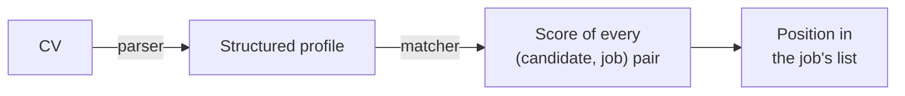
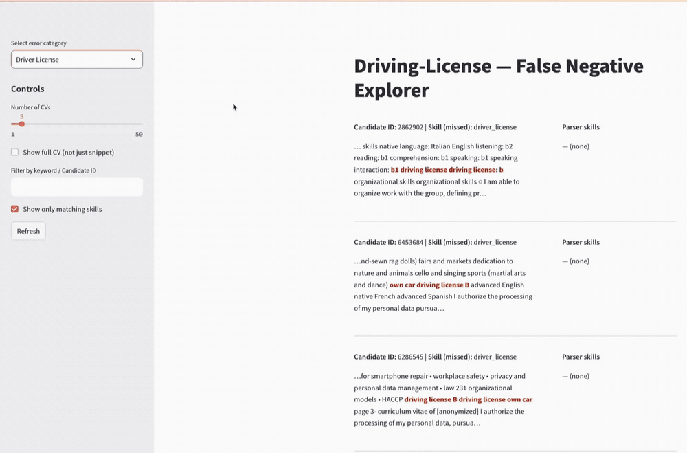

<div align="center">

# Hiring CV Bias

**Errors of a CV parser and their effect on the selection of candidates**

[Francesco Baiocchi](https://github.com/francescobaio) · [Leonardo Petrilli](https://github.com/leonardopetrilli)

University of Bologna · *AI in Industry* and *Ethics in Artificial Intelligence*

[](https://github.com/francescobaio/hiring_cv_bias/actions/workflows/tests.yml)
[](https://francescobaio.github.io/hiring_cv_bias/)
[](LICENSE)

[**Website**](https://francescobaio.github.io/hiring_cv_bias/) ·
[**Report (PDF)**](report.pdf) ·
[**Slides**](https://francescobaio.github.io/hiring_cv_bias/pages/05-presentation.html)

</div>

## Overview

Recruiting agencies use software to read CVs and to rank candidates. A *parser* extracts a structured profile from
each CV (driving licenses, languages, job titles, skills), and a *matcher* scores the profile against the job offers.
An error or a bias in these steps can exclude qualified candidates.



This repository studies the pipeline of Adecco on anonymized data, in two parts:

1. **Bias of the CV parser** (project of *AI in Industry*). We compare what a proprietary parser extracts with what is
   written in the CV text, and we measure whether its errors differ across gender, macro-region and CV length.
2. **Fairness audit of the selection** (project of *Ethics in Artificial Intelligence*, Module 2). We follow the
   parser's errors down to the selection: do they change who is selected for a job, and do they penalize some groups
   more than others?

<p align="center">
  
</p>

> [!NOTE]
> The CV data are anonymized but proprietary, so they are not in the repository and the experiments on them cannot be
> reproduced without them. The unit tests and the toy mitigation example need no data.

## Main results

### Bias of the CV parser

The parser misses much of what is in the CVs. The miss rates are similar across gender and macro-region.

| field | recall of the parser against our extractors |
|:---|---:|
| driving licenses | 0.41 |
| languages | 0.66 |
| job titles | 0.55 |

### Fairness audit

* Adecco's match score is a weighted sum of seven components. Our reconstruction reproduces 99.9% of the scores
  exactly.
* The parser's errors reach the selection: correcting them changes the outcome of 8.3% of the (candidate, job) pairs.
* Every group is selected at the same rate (independence holds), and there is no gender gap.
* The decisions on candidates of the South are wrong more often, in both directions (separation and sufficiency
  fail). The cause is mostly in the job lists, not in the parser: southern jobs more often require no skill that
  separates the candidates, so the scores are close to the cut and any noise flips more decisions.
* The usual mitigation techniques have little to act on in the real system, so they are shown on a toy case.

The full study is in the [report](report.pdf) and on the [website](https://francescobaio.github.io/hiring_cv_bias/).

## Repository structure

```text
hiring_cv_bias/
├── bias_detection/              # AI in Industry: errors of the parser
│   ├── fuzzy/                   # exact and semantic matching of job titles (ESCO)
│   └── rule_based/              # regex extractors for licenses and languages,
│                                #   evaluation per group, Streamlit app
├── cleaning/                    # cleaning of the raw CVs
├── exploration/                 # distributions and disparity metrics of the parsed skills
├── hard_soft_skills_labelling/  # labeling of the skills as hard or soft
├── translation/                 # translation of the CVs into English
├── reverse_matching/            # AI Ethics, phase 1: from the raw files to the pairs dataset
│   ├── loader.py                # parser output, false negatives, ESCO labels
│   ├── profiles.py              # three versions of a profile: real (P), parser (O), corrected (C)
│   ├── components.py            # the rules of the score components
│   ├── scoring.py               # outliers, weights, the formula and its exact check
│   ├── experience.py            # estimate of the Experience component with a sentence encoder
│   ├── build.py                 # builds data/ethics/pairs.parquet
│   └── audit.py                 # tables of the data audit
├── fairness/                    # AI Ethics, phases 2 to 4
│   ├── protocol.py              # what counts as a selection: ranking, ties, outcomes
│   ├── metrics.py               # independence, separation, sufficiency, bootstrap
│   ├── robustness.py            # margins to the cut, classes of lists, noise
│   ├── mitigation.py            # toy case: reweighing, Prejudice Remover, equalized odds
│   └── plots.py                 # figures
└── config.py                    # paths of the data

notebooks/
├── ai_in_industry/              # data_cleaning, data_exploration, distributions_analysis, bias_detection
└── ethics/                      # data_audit_and_protocol, propagation, mitigation

tests/                           # unit tests of reverse_matching and fairness
pages/, index.qmd, _quarto.yml   # the website and the slides (Quarto)
report.pdf                       # the final report of the AI Ethics project
```
