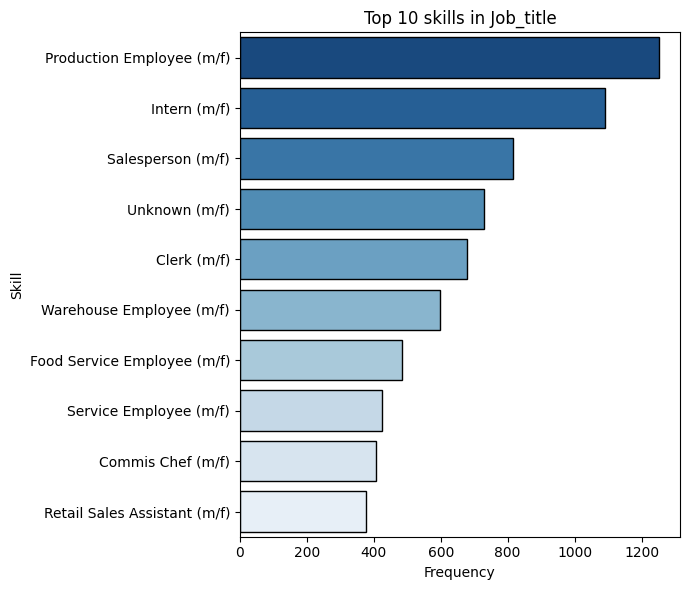
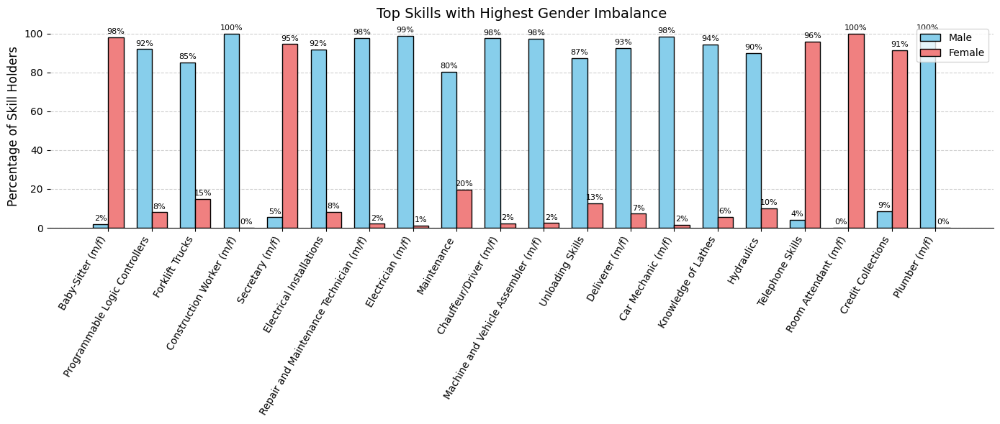

This page outlines the steps we followed to answer the questions of the [problem statement](01-problem.qmd).

```{mermaid}
flowchart LR
  A["Raw CVs"] --> B["Translation<br/>and labeling"]
  B --> C["Cleaning"]
  C --> D["Exploration"]
  D --> E["Distributions"]
  E --> F["Bias detection"]
```

## Setup

Two tasks prepare the data for the rest of the pipeline:

1. **Translating the CVs from Italian into English**, so that semantic matching can be applied consistently.
2. **Labeling every skill extracted by the parser as hard or soft**, with an LLM
   ([notebook](../hiring_cv_bias/hard_soft_skills_labelling/hard_soft_skill_labelling.html)).

## 1. Data cleaning

We standardized the raw, anonymized CV texts and filtered out the ones with structural issues:

- empty, whitespace-only or very short text;
- high repetition;
- low token and vocabulary richness;
- corrupted CVs with a fraction of invalid characters;
- CVs with placeholder tails (e.g. "XXXXXXXXXX…");
- CVs with poor translations.

The parsed skills of the candidates with corrupted CVs were excluded too. The demographic data of the candidates (age,
gender and location) were then analyzed to find correlations or redundancies among the features.
[Cleaning notebook](../notebooks/ai_in_industry/data_cleaning.html).

## 2. Exploratory analysis

On the cleaned data we explored the skills extracted by the parser:

- **distribution of parsed skills and job information**: how skills are distributed across roles and sectors;
- **skills per candidate**: how many skills each candidate has, flagging the outliers;
- **hard and soft skills**: how the two distributions compare.

{width=85%}

[Exploration notebook](../notebooks/ai_in_industry/data_exploration.html).

## 3. Distributions analysis

This step looks for imbalances in the parsed skills across **gender**, **location** and **hard and soft skills**. To
quantify them we defined disparity metrics, such as the Gini index and a custom bias strength measure. Detecting these
imbalances flags the biases introduced by the parser using only the raw CVs and their parsed output.

{width=85%}

[Distributions analysis notebook](../notebooks/ai_in_industry/distributions_analysis.html).

## 4. Bias detection

We detect the parser's errors with a hybrid pipeline:

- **Skills** (driving licenses, `DRIVERSLIC`, and languages, `LANGUAGE_SKILL`): a **regex-based extractor** scans
  every CV for the patterns of driving licenses and language proficiencies, in every variant and format used by the
  candidates.
- **Job titles**, in two steps:
  1. **rule-based exact matching** against the official [ESCO](https://esco.ec.europa.eu/en/about-esco) list of
     European occupations, keeping the titles that appear in the raw CV text;
  2. **semantic matching**, which catches synonyms and paraphrases of the same job, so that the extraction is robust
     to how the parser names each job (e.g. ESCO *Postman* against the parsed *Postal operator*, similarity 0.64).

Taking our pipeline as the reference, we measured the performance of the parser by comparing its output with ours. We
focused on the **false negatives**: candidates for whom our extractor finds a match but the parser returns nothing,
with regular expressions chosen for high precision.

A **Streamlit app** lets one inspect single candidates: for each false negative it shows the raw CV, with the matched
segments highlighted in red, next to the skills the parser assigned to that candidate.

Finally, we assessed whether the parser's errors hit some groups more than others, across gender, location and CV
length. [Bias detection notebook](../notebooks/ai_in_industry/bias_detection.html).
