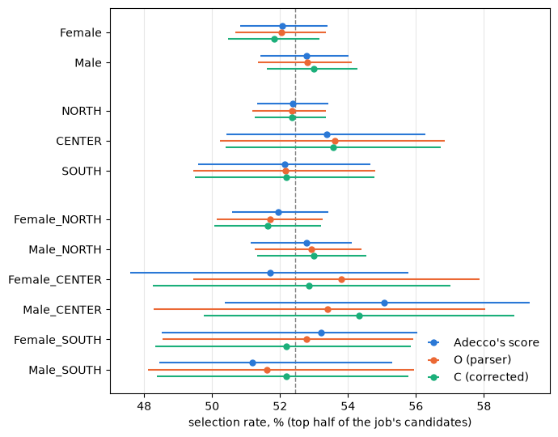
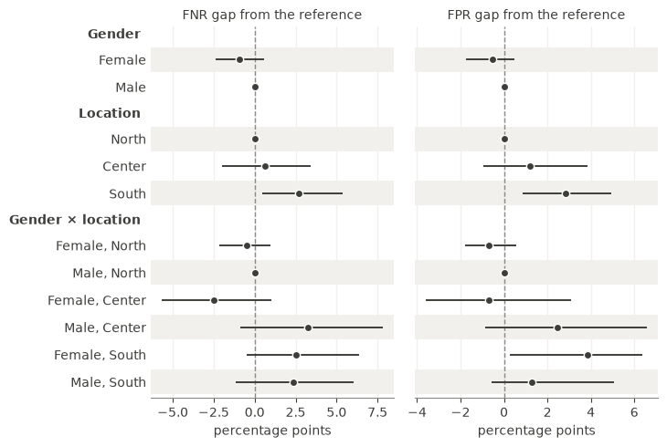
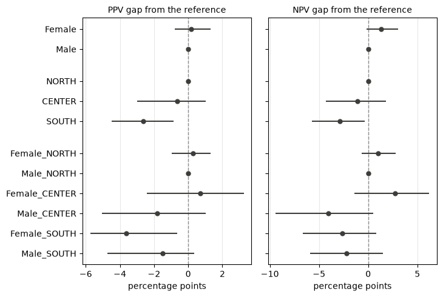
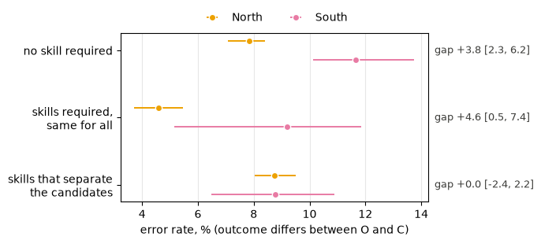
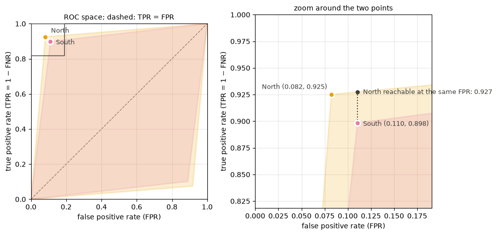

::: {.callout-note}
**Work in progress.** This page sums up phases 1–3 of the AI Ethics extension. Every number comes from a cell
output of the latest runs (1 November 2026) of the notebooks in `notebooks/ethics/` (`data_audit_and_protocol`,
`propagation`); the section in brackets, e.g. (3.3), points to the notebook section. The
notebooks published on this site are an earlier version and will be updated with the next merge.
:::

## The question

The previous pages measured the parser's errors: information that is in the CV text but missing from the parser
output. An error matters only if it changes a decision. Adecco's *reverse matching* gives a score to every
(candidate, job) pair. Read from the job's side, the scores rank the candidates of each job, as a recruiter would see
them. We ask:

* **RQ1**: Do the parser's errors reach the selection, and do they penalize some groups (gender, macro-region,
  women of the South) more than others?
* **RQ2**: If some groups are penalized, which mitigations can reduce the gap, and at what cost?
* **RQ3**: What drives the effect of the parser's errors, and how robust are the conclusions to our choices?

```
CV ──parser──► profile ──matcher──► score for every (candidate, job) ──► position among the job's candidates
```

Every candidate profile comes in three versions:

| version | content | role |
|---|---|---|
| **P** | the real Adecco profile | validates the reconstructed matcher |
| **O** – Original | licenses, languages, job titles **only as read by the parser** | the fully automatic pipeline |
| **C** – Corrected | O + the false negatives recovered from the CV text | the parser without its misses |

::: {.callout-tip}
## Findings so far

* **The errors reach the selection.** Correcting the parser changes the outcome of **8.2%** of the pairs.
* **No group loses places.** Selection rates are the same for every group, with O and with C (independence holds).
* **No gender gap against women.** With the top half no gender gap is significant; with the top 3 two small gaps
  favor women.
* **The South gets more wrong decisions**, in both directions: higher false negative *and* false positive rate,
  lower predictive values (separation and sufficiency fail). With both outcomes, the higher FNR and the lower PPV
  remain.
* **Mostly the lists, not the parser.** Southern candidates sit closer to the cut, because most southern jobs
  require no skill that separates the candidates. With the North's margins half of the gap goes; where the required
  skills separate the candidates, the South's gap is 0.3 points and not significant.
* **RQ2 is open.** The usual mitigation techniques have nothing to act on here (see [What a mitigation could do](#what-a-mitigation-could-do)).
  Section 3.6 answers the first part of RQ3, what drives the effect; the robustness to our choices is covered only
  for the top 3 and for noise on `Experience`.
:::

## Phase 1 – Data and audit

### The data

`ReverseMatching.xlsx` holds 51,490 pairs (51,468 after removing 22 duplicates) for 7,769 candidates; 7,521 of
them have a clean CV. Lists are short: the median job has 3 candidates, and only 3,431 of 9,238 jobs have at least 5.
`Age_bucket` is a function of gender in the file (all women 55–74, all men 25–34), so it is corrupted and never
used. The sensitive attributes are **Gender**, **Location** (North, Center, South) and their intersection (1.1).

### The matcher is a known formula

A least-squares fit of Adecco's score on its seven components gives almost round weights (1.2):

$$\text{score} = 2\,\text{Experience} + \text{Interest} + \text{match\_skills} + \text{Distance} + 0.3\,(\text{Card} + \text{Languages} + \text{Regulated})$$

* The rounded formula reproduces **99.88%** of the 50,358 scores exactly (error below 10⁻⁴).
* 1,110 pairs (2.2%, in 143 jobs) score above 6.41, the box-plot upper whisker. The formula cannot reach them (its
  maximum is 5.9), so they contain something outside the components and we leave them out.
* Five components can be recomputed from the profile and the job requirements. Our rules agree with Adecco's values
  on 99.1% (`Card_match`) to 100% (`Distance_match`) of the pairs.

### Estimating `Experience`

`Experience` is a similarity between the job title and the candidate's past titles, computed by an internal model,
and the job title is not in the data. We estimate it with the job category and a sentence encoder, and pick the
encoder that best reproduces Adecco's value on P (1.3):

| estimator | Spearman | MAE | gross errors |
|---|:-:|:-:|:-:|
| lexical baseline | 0.806 | 0.278 | 4,625 |
| MiniLM-L12 | 0.765 | 0.136 | 504 |
| mpnet-base | 0.847 | 0.107 | 189 |
| **e5-base** | **0.897** | **0.017** | **0** |
| e5-large | 0.876 | 0.021 | 0 |
| sentence-BERTino (Italian only) | 0.897 | 0.137 | 863 |

*Gross error*: estimate below 0.4 where Adecco gives more than 0.8. `multilingual-e5-base` is the only encoder with no
gross error, the lowest MAE and the highest Spearman, and it is already on Adecco's scale (lowest estimate 0.81
against Adecco's 0.83), so its cosine is used as is, with no calibration.

{width=60%}

### The three profiles

The share of candidates with at least one item per field (1.4):

| field | P | O | C |
|---|:-:|:-:|:-:|
| licenses | 52.4% | 27.8% | 59.3% |
| languages | 46.6% | 87.9% | 97.8% |
| job titles | 99.97% | 91.2% | 95.0% |

**The real profile is not the parser output.** Of the 2,161 candidates with a license found by the parser, only 17.5%
have any license in P; for languages it is 39.3%. Job titles do come from the parser (100% have titles in P), but the
lists share an item only in 50.4% of the cases. So the real matcher used a partly manual profile, and we measure the
parser only as **O against C**. Over all pairs, correcting the parser changes `Card_match` in 9.5% of them,
`Languages_match` in 6.4%, `Experience` in 17.4% and the score in 31.5%.

## Phase 2 – Protocol

Fixed before computing any fairness number (2.1):

* **Unit**: a (candidate, job) pair.
* **Selected**: the candidate is in the top half of the job's candidates, ranked by score (stricter variant: top 3).
* **Ties**: broken by one random number per pair, the same for every score, so every job selects exactly ⌈n/2⌉
  candidates and an outcome changes between versions only because the score changes.
* **Jobs kept**: at least 5 Female or Male candidates.
* **Intervals**: 95% bootstrap over candidates (1,000 draws), since a candidate appears in several pairs.

The protocol keeps 36,760 of 48,816 pairs (75.3%), 3,344 jobs and 6,510 candidates. The North holds most of them:

| group | pairs | jobs | candidates |
|---|--:|--:|--:|
| Female_NORTH | 13,798 | 2,394 | 2,290 |
| Male_NORTH | 15,346 | 2,558 | 2,580 |
| Female_CENTER | 1,669 | 365 | 402 |
| Male_CENTER | 1,631 | 386 | 360 |
| Female_SOUTH | 2,022 | 326 | 397 |
| Male_SOUTH | 2,294 | 342 | 481 |

**Outcomes under the four scores** (top half, 2.2):

| score | decided by the draw | agrees with Adecco |
|---|:-:|:-:|
| Adecco | 20.8% | – |
| P | 18.3% | 96.7% |
| O | 6.0% | 81.5% |
| C | 5.7% | 84.3% |

* Our score on P agrees with Adecco on **96.7%** of the decisions: the reconstruction works.
* With Adecco's own score, one decision in five is a tie across the cut, decided by the draw.
* From O to C, **8.2%** of the decisions change: 1,514 pairs enter the top half and 1,514 leave it.

## Phase 3 – Propagation and fairness (RQ1)

C is the label Y and O the decision D: errors are errors of O relative to C. Each group is compared with a
reference group (`Male`, `NORTH`, `Male_NORTH`).

### 3.1 What the correction changes

The correction adds a license to 33.4% of the protocol candidates, a language to 41.1% and a job title to 47.1%. It
changes the score of about one pair in four in every region (North 26.5%, Center 27.2%, South 26.0%).

The outcome changes for **3,028 pairs (8.2%)**. Among the pairs with their own score changed, a new job title is the
most common cause. **1,339 of them keep the same score**: no score goes down with C, and all 1,339 leave the top half,
overtaken by a competitor whose CV was corrected.

### 3.2 Independence: selection rates



Every SPD lies between −1.6 and +2.3 points and every DI between 0.97 and 1.04, with Adecco's score, O and C. Every
SPD interval contains 0, every DI interval contains 1, and the lowest DI bound is 0.90, above the 0.8 of the
four-fifths rule. **Independence holds, before and after the correction.**

### 3.3 Separation: the parser's errors per group



| group | FNR | FPR | FNR gap | FPR gap |
|---|:-:|:-:|:-:|:-:|
| NORTH | 7.5 | 8.2 | – | – |
| CENTER | 8.1 | 9.4 | 0.6 [−2.0, 3.4] | 1.2 [−0.9, 3.8] |
| **SOUTH** | **10.2** | **11.0** | **2.7 [0.5, 5.4]** | **2.8 [0.9, 5.0]** |
| Female | 7.4 | 8.4 | −0.9 [−2.4, 0.5] | −0.5 [−1.7, 0.5] |
| Female_SOUTH | 10.2 | 12.4 | 2.5 [−0.5, 6.4] | **3.8 [0.3, 6.4]** |

* **The South is the only area whose errors differ from the North, in both directions.** O leaves out more of the
  southern pairs that C selects, and selects more of the southern pairs that C does not select.
* Among the intersectional groups only the FPR of `Female_SOUTH` excludes 0 (12.4% against 8.6% for `Male_NORTH`).
* Women and men: no gap.

### 3.4 Sufficiency: how reliable the parser's decision is



Both predictive values are at least 87% in every group. The South is again the only area that differs: O's
selections are confirmed by C in 89.9% of the southern pairs against 92.5% in the North (gap −2.6 [−4.5, −0.9]), its
rejections in 88.9% against 91.8% (gap −2.9 [−5.7, −0.4]). `Female_SOUTH` has a lower PPV (88.8% against 92.4%, gap
−3.6 [−5.7, −0.6]).

### 3.5 Top 3

With the stricter selection, the higher FNR (4.4 [0.3, 8.3]) and the lower PPV (−4.5 [−7.8, −1.6]) of the South
remain; its FPR and NPV gaps do not. The gaps of `Female_SOUTH` do not remain (FNR 5.1 [−0.6, 11.3]).

Some gaps exclude 0 only with the top 3: women have a lower FPR (−0.8 [−1.6, −0.1]) and a higher PPV
(+2.3 [0.4, 4.0]), both in their favor; the Center has a higher FPR (2.0 [0.5, 3.9]), and `Male_CENTER` a higher FPR
(3.3 [0.8, 6.8]) and a lower NPV (−4.0 [−7.8, −0.9]).

3.3 to 3.5 hold 64 gaps, so about three would exclude 0 by chance. The gaps seen with **both** outcomes are the
higher FNR and the lower PPV of the South; the `Female_SOUTH` gaps, seen with one outcome only and of the same size
as the South's, are read as the South's effect.

### 3.6 Why the South: the lists, not the readers

The correction touches southern and northern pairs alike (26.0% against 26.5%), yet flips more southern outcomes.
A score change flips an outcome only when the pair is close to the cut. The metric of this section is the **error
rate**, the share of a group's pairs whose outcome differs between O and C.

**Southern pairs are closer to the cut.** The margin is the distance between the pair's score under O and the score
of the last selected candidate.

| region | median margin | pairs within 0.1 | decided by the draw, Adecco's score |
|---|:-:|:-:|:-:|
| NORTH | 0.35 | 31.5% | 19.5% |
| CENTER | 0.30 | 34.9% | 21.0% |
| SOUTH | 0.16 | 42.6% | 29.1% |

**With the North's margins, half of the gap goes.** The South's error rate is 10.6% against 7.8% (gap 2.8 [1.3, 4.4]).
Weighting it by the North's margins gives 9.3% (gap 1.5 [0.1, 3.1]), an interval that only just excludes 0.

**Why the margins are small: jobs without separating skills.** `match_skills` is the term that spreads the scores.
When a job requires no skill, or skills that give every candidate the same value, it cannot separate the candidates.

| class of list | share of North lists | share of South lists | error North | error South | gap |
|---|:-:|:-:|:-:|:-:|:-:|
| no skill required | 41.9% | 59.9% | 7.8 | 11.6 | **3.8 [2.2, 6.2]** |
| required, same for all | 13.7% | 15.1% | 4.6 | 9.2 | **4.5 [0.5, 7.4]** |
| required, separating | 44.3% | 25.0% | 8.6 | 9.0 | 0.3 [−2.2, 2.7] |

{width=80%}

**Any noise does this, not only the parser.** Adding the same Gaussian noise to everyone's `Experience` and
re-ranking flips more southern decisions, and only in the lists that cannot separate the candidates (share of flipped
decisions, mean of 20 draws):

| class of list | North, σ = 0.05 | South, σ = 0.05 | North, σ = 0.10 | South, σ = 0.10 |
|---|:-:|:-:|:-:|:-:|
| no skill required | 11.2 | 17.4 | 15.3 | 21.7 |
| required, same for all | 12.9 | 17.4 | 17.0 | 22.0 |
| required, separating | 7.1 | 6.8 | 10.8 | 9.8 |

### What a mitigation could do

The harm is a gap in separation and sufficiency, not in independence, and it comes from noise meeting fragile lists.

* **Change the matcher**: there is nothing to train. The matcher is a formula with seven known weights and a cut, so
  in-processing has no loss to add a fairness term to.
* **Post-process the decisions** for equalized odds (Hardt et al., 2016): the South's point lies inside the
  North's reachable region, so equalizing means **bringing the North down** to the South, and no southern decision
  improves.



The levers left are outside the parser and the matcher: the job's requirements (lists with separating skills show no
gap) and a human decision where the margin is too small to trust. Whether these count as mitigation is still open
(RQ2).

**Limits.** The gap at equal margin only just excludes 0; the "same for all" class has 501 southern pairs and a wide
interval; the perturbation is an average of 20 draws, with no intervals.
