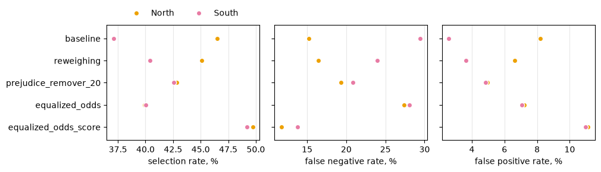

::: {.callout-note}
This page sums up the four phases of the AI Ethics extension. Every number comes from a cell output of the notebooks
in `notebooks/ethics/`; the section in brackets, e.g. (3.3), points to the notebook section.

🔗 [Data audit and protocol](../notebooks/ethics/data_audit_and_protocol.html) (phases 1 and 2) ·
[Propagation](../notebooks/ethics/propagation.html) (phase 3) ·
[Mitigation](../notebooks/ethics/mitigation.html) (phase 4)
:::

## The question

The previous pages measured the parser's errors: information that is in the CV text but missing from the parser
output. An error matters only if it changes a decision. Adecco's *reverse matching* gives a score to every
(candidate, job) pair. Read from the job's side, the scores rank the candidates of each job, as a recruiter would see
them. We ask:

* **RQ1**: Do the parser's errors reach the selection, and do they penalize some groups (gender, macro-region,
  women of the South) more than others?
* **RQ2**: If some groups are penalized, which mitigations can reduce the gap, and at what cost?
* **RQ3**: When does a parser error change a selection, and why more often for some groups? How robust are the conclusions to our choices?

```
CV ──parser──► profile ──matcher──► score for every (candidate, job) ──► position among the job's candidates
```

Every candidate profile comes in three versions:

| version | content | role |
|---|---|---|
| **P** | the real Adecco profile | validates the reconstructed matcher |
| **O** – Original | licenses, languages, job titles **only as read by the parser** | the fully automatic pipeline |
| **C** – Corrected | O + the false negatives recovered from the CV text | the reference for the parser's errors |

::: {.callout-tip}
## Findings

* **The errors reach the selection.** Correcting the parser changes the outcome of **8.3%** of the pairs.
* **No group loses places.** Selection rates are the same for every group, with O and with C (independence holds).
* **No gender gap against women.** With the top half no gender gap is significant; with the top 3 two small gaps
  favor women.
* **The South gets more wrong decisions**, in both directions: higher false negative *and* false positive rate,
  lower predictive values (separation and sufficiency fail). With both outcomes, the higher FNR and the lower PPV
  remain.
* **The cause is mostly in the job lists, not in the parser.** Southern candidates sit closer to the cut, because most southern jobs
  require no skill that separates the candidates. With the North's margins half of the gap goes; where the required
  skills separate the candidates, the South's gap is 0.0 points and not significant.
* **The usual mitigations have little to act on.** The matcher is a fixed formula with a quota per list and there is
  no ground truth. Equalized odds post-processing would only bring the North down to the South (see
  [What a mitigation could do](#what-a-mitigation-could-do)). A [toy case](#phase-4-mitigation-on-a-toy-case) shows
  pre-, in- and post-processing where they can be applied.
:::

## Phase 1 – Data and audit

### The data

`ReverseMatching.xlsx` holds 51,490 pairs (51,468 after removing 22 duplicates) for 7,769 candidates; 7,521 of
them have a clean CV. Lists are short: the median job has 3 candidates, and only 3,431 of 9,238 jobs have at least 5.
`Age_bucket` is a function of gender in the file (all women 55–74, all men 25–34), so it is corrupted and never
used. The sensitive attributes are **Gender**, **Location** (North, Center, South) and their intersection (1.1).

### The matcher is a known formula

A least-squares fit of Adecco's score on its seven components gives almost round weights (1.2):

$$\text{score} = 2\,\text{Experience} + \text{Interest} + \text{match\_skills} + \text{Distance} + 0.3\,(\text{Card} + \text{Languages} + \text{Regulated})$$

* The rounded formula reproduces **99.88%** of the 50,358 scores exactly (error below 10⁻⁴).
* 1,110 pairs (2.2%, in 143 jobs) score above 6.41, the box-plot upper whisker. The formula cannot reach them (its
  maximum is 5.9), so they contain something outside the components and we leave them out.
* Five components can be recomputed from the profile and the job requirements. Our rules agree with Adecco's values
  on 99.7% (`Card_match`) to 100% (`Distance_match`) of the pairs. For licenses, languages and regulated trainings,
  one of the items the job lists is enough.

### Estimating `Experience`

`Experience` is a similarity between the job title and the candidate's past titles, computed by an internal model
that we do not have. We estimate it with the job category and a sentence encoder, and pick the
encoder that best reproduces Adecco's value on P (1.3):

| estimator | Spearman | MAE | gross errors |
|---|:-:|:-:|:-:|
| lexical baseline | 0.806 | 0.278 | 4,625 |
| MiniLM-L12 | 0.765 | 0.135 | 504 |
| mpnet-base | 0.847 | 0.106 | 189 |
| **e5-base** | **0.897** | **0.017** | **0** |
| e5-large | 0.876 | 0.021 | 0 |
| sentence-BERTino (Italian only) | 0.896 | 0.137 | 863 |

*Gross error*: estimate below 0.4 where Adecco gives more than 0.8. `multilingual-e5-base` has no gross error, the
lowest MAE and the highest Spearman, and it is already on Adecco's scale (lowest estimate 0.81 against Adecco's
0.83), so its cosine is used as is, with no calibration.

{width=60%}

### The three profiles

The share of candidates with at least one item per field (1.4):

| field | P | O | C |
|---|:-:|:-:|:-:|
| licenses | 52.4% | 27.8% | 59.3% |
| languages | 46.6% | 87.9% | 97.8% |
| job titles | 99.97% | 91.2% | 94.9% |

**The real profile is not the parser output.** Of the 2,161 candidates with a license found by the parser, only 17.5%
have any license in P; for languages it is 39.3%. Job titles do come from the parser (100% have titles in P), but the
lists share an item only in 50.4% of the cases. So the real matcher used a partly manual profile, and we measure the
parser only as **O against C**. Over all pairs, correcting the parser changes `Card_match` in 10.0% of them,
`Languages_match` in 6.5%, `Experience` in 11.2% and the score in 26.3%.

## Phase 2 – Protocol

Fixed before computing any fairness number (2.1):

* **Unit**: a (candidate, job) pair.
* **Selected**: the candidate is in the top half of the job's candidates, ranked by score (stricter variant: top 3).
* **Ties**: broken by one random number per pair, the same for every score, so every job selects exactly ⌈n/2⌉
  candidates and an outcome changes between versions only because the score changes.
* **Jobs kept**: at least 5 Female or Male candidates.
* **Intervals**: 95% bootstrap over candidates (1,000 draws), since a candidate appears in several pairs.

The protocol keeps 36,760 of 48,816 pairs (75.3%), 3,344 jobs and 6,510 candidates. The North holds most of them:

| group | pairs | jobs | candidates |
|---|--:|--:|--:|
| Female_NORTH | 13,798 | 2,394 | 2,290 |
| Male_NORTH | 15,346 | 2,558 | 2,580 |
| Female_CENTER | 1,669 | 365 | 402 |
| Male_CENTER | 1,631 | 386 | 360 |
| Female_SOUTH | 2,022 | 326 | 397 |
| Male_SOUTH | 2,294 | 342 | 481 |

**Composition of the lists** (2.1). Almost every list has candidates from one region only: 3,158 of 3,344 lists
(94.4%), with 93.7% of the pairs. Women and men are in the same lists: only 15.8% of the lists have one gender.

**Outcomes under the four scores** (top half, 2.2):

| score | decided by the draw | agrees with Adecco |
|---|:-:|:-:|
| Adecco | 20.8% | – |
| P | 18.2% | 96.9% |
| O | 6.0% | 81.5% |
| C | 5.7% | 84.2% |

* Our score on P agrees with Adecco on **96.9%** of the decisions: the reconstruction works.
* With Adecco's own score, one decision in five is a tie across the cut, decided by the draw.
* From O to C, **8.3%** of the decisions change: 1,522 pairs enter the top half and 1,522 leave it.

## Phase 3 – Propagation and fairness (RQ1)

C is the label Y and O the decision D: errors are errors of O relative to C. Each group is compared with a
reference group (`Male`, `NORTH`, `Male_NORTH`).

### 3.1 What the correction changes

The correction adds a license to 33.4% of the protocol candidates, a language to 41.1% and a job title to 47.1%. It
changes the score of about one pair in four in every region (North 26.8%, Center 27.6%, South 26.6%).

The outcome changes for **3,044 pairs (8.3%)**. Among the pairs with their own score changed, a new job title is the
most common cause. **1,347 of them keep the same score**: no score goes down with C, and all 1,347 leave the top half,
overtaken by a competitor whose CV was corrected.

### 3.2 Independence: selection rates


Every SPD lies between −1.6 and +2.3 points and every DI between 0.97 and 1.04, with Adecco's score, O and C. Every
SPD interval contains 0, every DI interval contains 1, and the lowest DI bound is 0.90, above the 0.8 of the
four-fifths rule. Independence holds, before and after the correction.

For the regions this is expected: almost every list has one region only and selects half of its candidates, so each
region is selected at about the same rate whatever the score. For gender it is a result, because women and men are in
the same lists.

### 3.3 Separation: the parser's errors per group


| group | FNR | FPR | FNR gap | FPR gap |
|---|:-:|:-:|:-:|:-:|
| NORTH | 7.5 | 8.3 | – | – |
| CENTER | 8.1 | 9.4 | 0.6 [−2.0, 3.4] | 1.1 [−1.0, 3.8] |
| **SOUTH** | **10.2** | **11.0** | **2.6 [0.4, 5.3]** | **2.8 [0.8, 4.9]** |
| Female | 7.4 | 8.3 | −1.0 [−2.4, 0.6] | −0.7 [−1.9, 0.3] |
| Female_SOUTH | 10.2 | 12.3 | 2.4 [−0.7, 6.2] | **3.6 [0.1, 6.2]** |

* The South is the only area whose errors differ from the North, in both directions. O leaves out more of the
  southern pairs that C selects, and selects more of the southern pairs that C does not select.
* Among the intersectional groups only the FPR of `Female_SOUTH` excludes 0 (12.3% against 8.7% for `Male_NORTH`).
* Women and men: no gap.

### 3.4 Sufficiency: how reliable the parser's decision is


Both predictive values are at least 87% in every group. The South is again the only area that differs: O's
selections are confirmed by C in 89.9% of the southern pairs against 92.5% in the North (gap −2.6 [−4.4, −0.9]), its
rejections in 88.9% against 91.7% (gap −2.8 [−5.6, −0.2]). `Female_SOUTH` has a lower PPV (88.8% against 92.2%, gap
−3.4 [−5.5, −0.5]).

### 3.5 Top 3

With the stricter selection, the higher FNR (4.4 [0.4, 8.3]) and the lower PPV (−4.5 [−7.9, −1.9]) of the South
remain; its FPR and NPV gaps do not. The gaps of `Female_SOUTH` do not remain (FNR 5.5 [−0.1, 11.7]).

Some gaps exclude 0 only with the top 3: women have a lower FPR (−0.9 [−1.6, −0.1]) and a higher PPV
(+2.4 [0.6, 4.2]), both in their favor; the Center has a higher FPR (1.9 [0.4, 3.9]), and `Male_CENTER` a higher FPR
(3.3 [0.8, 6.8]) and a lower NPV (−4.0 [−7.8, −1.0]).

3.3 to 3.5 hold 64 gaps, so about three would exclude 0 by chance. The gaps seen with **both** outcomes are the
higher FNR and the lower PPV of the South; the `Female_SOUTH` gaps, seen with one outcome only and of the same size
as the South's, are read as the South's effect.

### 3.6 Why the South: the margins and the job lists

The correction touches southern and northern pairs alike (26.6% against 26.8%), yet flips more southern outcomes.
A score change flips an outcome only when the pair is close to the cut. The metric of this section is the **error
rate**, the share of a group's pairs whose outcome differs between O and C.

**Southern pairs are closer to the cut.** The margin is the distance between the pair's score under O and the score
of the last selected candidate.

| region | median margin | pairs within 0.1 | decided by the draw, Adecco's score |
|---|:-:|:-:|:-:|
| NORTH | 0.35 | 31.4% | 19.5% |
| CENTER | 0.30 | 34.8% | 21.0% |
| SOUTH | 0.16 | 42.5% | 29.1% |

**With the North's margins, half of the gap goes.** The South's error rate is 10.6% against 7.9% (gap 2.7 [1.2, 4.3]).
Weighting it by the North's margins gives 9.4% (gap 1.5 [0.1, 3.1]), an interval that only just excludes 0.

**Why the margins are small: jobs without separating skills.** `match_skills` is the term that spreads the scores.
When a job requires no skill, or skills that give every candidate the same value, it cannot separate the candidates.

| class of list | share of North lists | share of South lists | gap in error rate, South − North |
|---|:-:|:-:|:-:|
| no skill required | 41.9% | 59.9% | **3.8 [2.3, 6.2]** |
| required, same for all | 13.7% | 15.1% | **4.6 [0.5, 7.4]** |
| required, separating | 44.3% | 25.0% | 0.0 [−2.4, 2.2] |

{width=80%}

**Random noise flips more southern decisions too.** We start from the real profile P, add the same Gaussian noise to
everyone's `Experience` and rank again. More southern decisions flip in every class, and most of all in the lists that
cannot separate the candidates (share of flipped decisions, mean of 20 draws):

| class of list | North, σ = 0.05 | South, σ = 0.05 | North, σ = 0.10 | South, σ = 0.10 |
|---|:-:|:-:|:-:|:-:|
| no skill required | 12.3 | 18.8 | 15.4 | 23.1 |
| required, same for all | 13.7 | 22.7 | 16.8 | 26.6 |
| required, separating | 8.4 | 11.6 | 10.6 | 13.5 |

### What a mitigation could do

The harm is a gap in separation and sufficiency, not in independence (3.6.5).

* **Change the matcher**: there is nothing to train. The matcher is a formula with seven fixed weights and a cut, so
  in-processing has no loss to add a fairness term to.
* **Post-process the decisions** for equalized odds (Hardt et al., 2016): a selected pair stays selected with
  probability `keep`, a rejected one becomes selected with probability `add`, per region.

| region | TPR | FPR | keep | add | TPR after | FPR after |
|---|:-:|:-:|:-:|:-:|:-:|:-:|
| NORTH | 92.5 | 8.3 | 0.97 | 0.03 | 89.8 | 11.1 |
| CENTER | 91.9 | 9.4 | 0.98 | 0.02 | 89.8 | 11.1 |
| SOUTH | 89.8 | 11.0 | 1.00 | 0.00 | 89.8 | 11.1 |


The South's point lies inside the North's reachable region, so equalizing means bringing the North down to the
South (leveling down): no southern decision improves.

**Limits.** C is not the truth: it holds what our extractors recovered. The gap at equal margin only just excludes 0;
the "same for all" class has 501 southern pairs and a wide interval; the perturbation is an average of 20 draws, with
no intervals.

## Phase 4 – Mitigation on a toy case

The techniques of the course need a matcher that is trained, a score with a threshold and true labels. The real case
has none of them, so we show the techniques on a toy case (4.1): one job opening in the North, candidates with two
scores (`skills`, `experience`) and a `distance` from the opening, which tells the region. The truth depends only on
the two scores. The past decisions follow the truth, but reject 30% of the qualified southern candidates. The matcher
is a logistic regression trained on the past decisions, and it never reads the region.

Every decision is evaluated on the test set against the truth (4.6). SPD and DI are those of the South against the
North.

| method | accuracy | rate North | rate South | SPD | DI | FNR North | FNR South | FPR North | FPR South |
|---|:-:|:-:|:-:|:-:|:-:|:-:|:-:|:-:|:-:|
| baseline | 86.5 | 46.5 | 37.1 | −9.4 | 0.80 | 15.2 | 29.5 | 8.2 | 2.6 |
| reweighing | 87.5 | 45.1 | 40.4 | −4.7 | 0.90 | 16.4 | 24.0 | 6.6 | 3.7 |
| Prejudice Remover (η = 20) | 87.5 | 42.8 | 42.6 | −0.2 | 0.99 | 19.3 | 20.8 | 4.9 | 4.8 |
| equalized odds, on the decisions | 82.5 | 39.9 | 40.0 | 0.1 | 1.00 | 27.4 | 28.1 | 7.2 | 7.1 |
| equalized odds, on the score | 88.2 | 49.7 | 49.2 | −0.5 | 0.99 | 11.7 | 13.8 | 11.1 | 11.0 |



* The baseline never reads the region, but it learns the bias through the distance: its coefficient is −1.82,
  although the truth ignores the distance. So fairness through unawareness fails.
* Reweighing (pre-processing) halves the gap, and the coefficient of the distance goes to −0.98.
* The Prejudice Remover (in-processing) closes the gap, with no loss of accuracy here, and the coefficient of the
  distance goes to −0.18.
* What equalized odds (post-processing) costs depends on what it reads. On the decisions alone it has the lowest
  accuracy, because a random flip adds no information. On the score it has the highest.

The toy is only a demonstration, and its numbers say nothing about Adecco's data.
