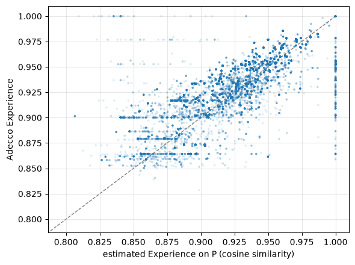
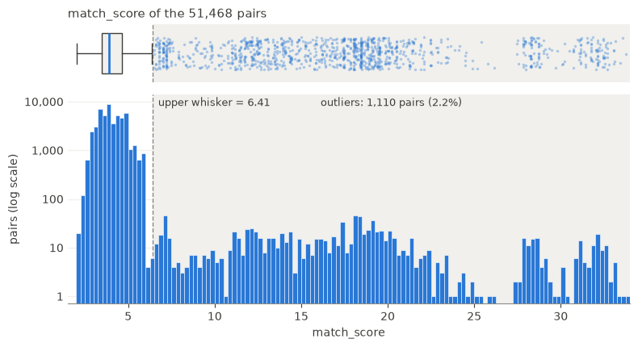
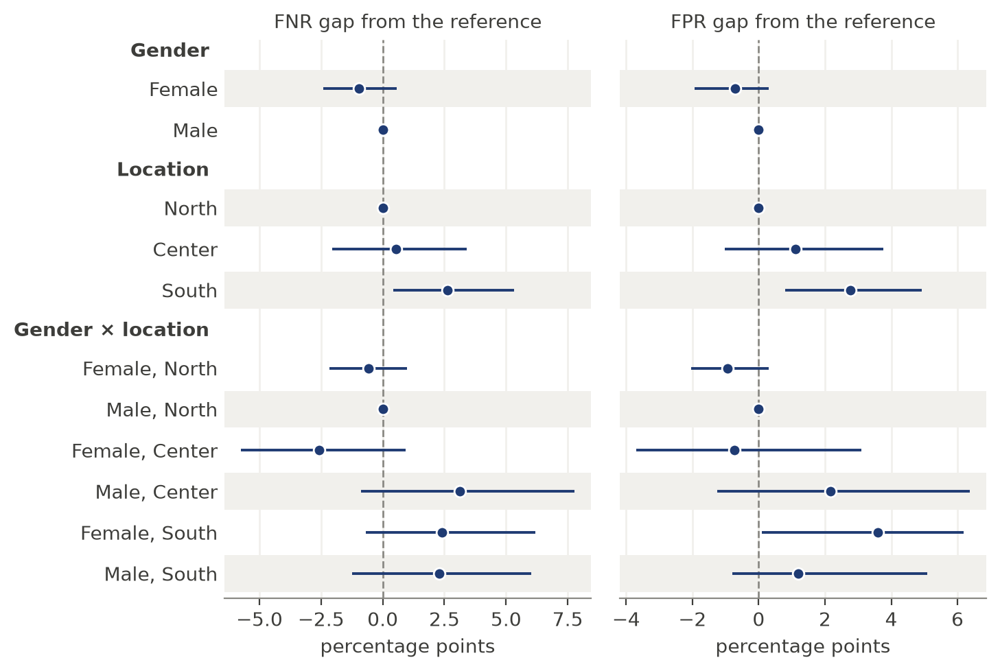
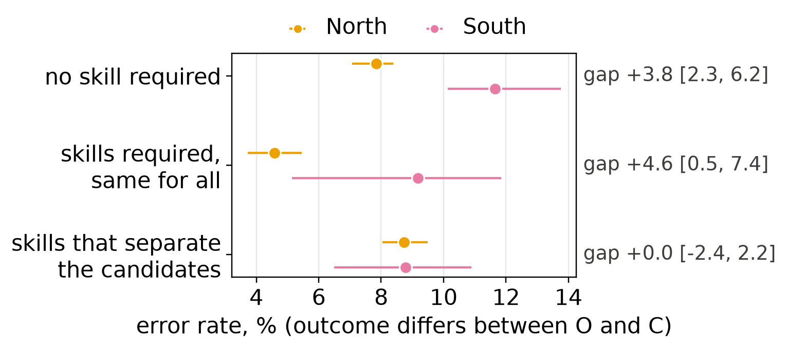
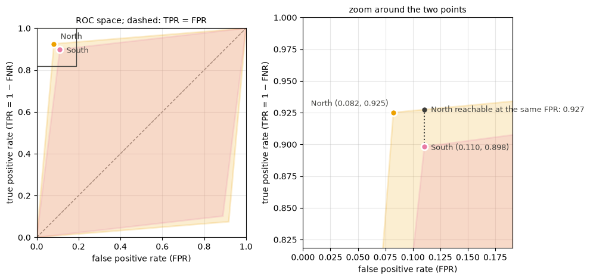

## {.beamer-title}

::: titlebox
[Do CV-Parser Errors Reach the Selection? A Fairness Audit of the Adecco Reverse Matching]{.t1}
[Ethics in Artificial Intelligence, Module 2]{.t2}
:::

[Francesco Baiocchi, Leonardo Petrilli]{.who}
[Supervisor: Prof. Roberta Calegari]{.prof}
[Master's Degree in Artificial Intelligence, University of Bologna]{.where}
[Fall 2026]{.when}

::: {.notes}
**Francesco.** Good morning. Together with Leonardo we present our project: a fairness audit of the Adecco reverse
matching. The title asks a simple question: when the CV parser makes a mistake, does that mistake reach the selection of
the candidates? And if it does, does it hurt some groups more than others? I will start introducing the problem and our
approach.
:::

## Our question

- At Adecco a *parser* turns each CV into a structured profile (licenses, languages, job titles, skills), and a
  *matcher* scores the profile against every job offer: the recruiter sees each job's candidates ordered by score
- Recruitment is a high-risk use of AI under the EU AI Act (Annex III, 4(a)): an error decides who gets access to a
  job
- In a previous project our extractors (regular expressions, ESCO matching) showed that the parser misses much of the
  CVs: recall [0.41]{.hl} on driving licenses, [0.66]{.hl} on languages, [0.55]{.hl} on job titles

::: block
::: block-title
What we want to know
:::
::: block-body
- **RQ1.** Do the parser's errors reach the selection, and do they penalize some groups (gender, macro-region) more
  than others?
- **RQ2.** If some groups are penalized, which mitigations can reduce the gap, and at what cost?
- **RQ3.** When does a parser error change a selection, and why more often for some groups? How robust are the
  conclusions?
:::
:::

::: {.notes}
**Francesco.** At Adecco every CV goes through two automatic steps. A *parser* reads the CV and extracts a structured profile:
driving licenses, languages, past job titles, skills. Then a *matcher* compares this profile with the requirements of every job offer and gives a score to every candidate-job pair. The recruiter sees the candidates of a job ordered by that score.

Recruitment is listed as a **high-risk use of AI** in Annex III of the European AI Act, because an error here decides who gets access to a job.

In a previous project we ran our own extractors on the CV text, and saw that the parser misses a large part of it, in the same way across gender and macro-region.

A missed item is a problem only if it changes a decision. So this project follows the errors one step further, down to the selection, with three research questions.

**RQ1.** Do the errors of the CV parser propagate to the selection on the job offers, and do they penalize some
groups, by gender or macro-region, more than others?

**RQ2.** If some groups are penalized, which mitigations can reduce the gap, and at what cost?

**RQ3.** When does a parser error change a selection, and why more often for some groups? And how robust are the
conclusions to our choices?
:::

## Three profiles, four phases

| version | content | role |
|:---|:---|:---|
| **P** | the real Adecco profile | validates the reconstruction |
| **O** | licenses, languages and job titles as read by the parser | the fully automatic pipeline |
| **C** | O plus the false negatives recovered from the CV text | the reference for the parser's errors |

- The real profile is not the parser output: of 2,161 candidates with a parsed license, only [17.5%]{.hl} have one in
  P. Licenses and languages are entered by hand; only the job titles come from the parser
- So the parser's bias is measured **between O and C**, and P only validates the reconstruction

::: block
::: block-title
Four phases
:::
::: block-body
1. Reconstruct the matcher, to score any profile
2. Fix what counts as a selection, before any fairness metric
3. Compare O and C group by group
4. Test what a mitigation can do
:::
:::

::: {.notes}
**Francesco.** We compare three versions of every candidate's profile. **P** is the real profile that Adecco used. **O** is the
profile with licenses, languages and job titles exactly as the parser read them: it is the fully automatic pipeline.
**C** is O plus the false negatives we recovered from the CV text: it is our reference for the parser's errors.

We found out that the real profile is not the parser output. Of the 2,161 candidates for whom
the parser found a driving license, only **17.5%** have a license in the real profile. Licenses and languages were
entered by hand; only the job titles come from the parser. So we never judge the parser against P: we measure its bias
only as the difference between O and C, and we use P to validate our reconstruction.

The work has four phases: we reconstruct the matcher, we fix what counts as a selection, we compare O and C group by group, and we test what a mitigation can do.
:::

## Phase 1: the seven components

- For every pair the data give the score and its seven components, each in $[0, 1]$, but not the rules that compute
  them
- We write the rules of six components and apply them to P: they agree with Adecco's values on more than
  [99.4%]{.hl} of the pairs

| component | value | agreement |
|:--------------------|:---------------------------------------------|---------:|
| `Interest` | 1 if the job category is among the candidate's categories of interest | 99.43% |
| `Card_match` | 1 if the candidate has at least one of the driving licenses the job lists, or the job lists none; otherwise 0 | 99.74% |
| `Languages_match` | the same, with the languages | 99.95% |
| `Regulated_Trainings_match` | the same, with the regulated trainings | 99.98% |
| `match_skills` | the share of the job's skills that the candidate has; 0 if the job lists none | 99.92% |
| `Distance_match` | 1 up to 10 km, 0.6 up to 20 km, 0.2 up to 25 km, 0 beyond | 100% |

::: block
::: block-title
Where the parser enters the score
:::
::: block-body
Only three components read fields of the parser: `Card_match` (licenses), `Languages_match` (languages) and
`Experience` (job titles).
:::
:::

::: {.notes}
**Leonardo.** For every candidate-job pair the data give us the score and its seven components, each between 0 and 1, but
not the rules that compute them. So we reconstruct them.

For six components we wrote simple rules, shown in the table: for example, Card_match is 1 if the candidate
has one of the licenses the job asks for. On the real profile our rules agree with Adecco's values on **more than
99.4%** of the pairs.

Only three components read what the parser extracts: Card_match, Languages_match, and Experience, which
is computed from the job titles.
:::

## Phase 1: Experience

- **`Experience`**: the "highest standardized similarity between the job title and the candidate's experience",
  computed by an internal model we do not have. We estimate it: 1 if the job category appears among the past titles,
  0 if there are no titles, otherwise the [highest cosine similarity]{.hl} between the category and a title

:::: {.columns}
::: {.column width="54%"}
| encoder | Spearman | MAE | gross errors |
|:---|---:|---:|---:|
| lexical baseline | 0.806 | 0.278 | 4,625 |
| MiniLM-L12 | 0.765 | 0.135 | 504 |
| mpnet-base | 0.847 | 0.106 | 189 |
| **e5-base** | [0.897]{.hl} | [0.017]{.hl} | [0]{.hl} |
| e5-large | 0.876 | 0.021 | 0 |
| sentence-BERTino (Italian) | 0.896 | 0.137 | 863 |

[On P, against Adecco's value. Gross error: below 0.4 where Adecco gives more than 0.8.]{.figure-note}

- 16% of the titles are in English: for *warehouse worker* and *magazziniere* the Italian encoder gives 0.39,
  [e5-base]{style="white-space: nowrap"} 0.87
:::

::: {.column width="46%"}

[e5-base against Adecco's `Experience`, one dot per pair of P whose candidate has titles.]{.figure-note}
:::
::::

::: {.notes}
**Leonardo.** Experience, comes from an internal model that we do not have, so we estimate it. The estimate is 1 if the job category appears among the candidate's past titles, 0 if there are no titles, and otherwise the highest cosine similarity between the category and a title.

On the real profile we know Adecco's value, so we can choose the encoder by comparing with it. The best is
multilingual-e5-base: it has the highest Spearman correlation, the lowest error, and no gross error. An Italian encoder
ranks the pairs almost as well, but 16% of the titles are in English, and it fails across languages: it gives 0.39 to
*warehouse worker* and *magazziniere* that is the same job.

We use the same estimate for P, O and C, so the three versions differ only in the titles.
:::

## Phase 1: the matcher is a formula

::: {.block .formula}
::: block-title
The score of a (candidate, job) pair
:::
::: block-body
$$
\begin{aligned}
\text{score} = {} & \text{2}\,\text{Experience} + \text{Interest} + \text{match_skills} + \text{Distance} \\
& + \text{0.3}\,(\text{Card} + \text{Languages} + \text{Regulated})
\end{aligned}
$$
:::
:::

:::: {.columns}
::: {.column width="50%"}
- A linear regression of the score on the seven components gives almost round coefficients
- Rounded to one decimal, they reproduce [99.88%]{.hl} of the 50,358 scores without outliers **exactly** (error below
  $10^{-4}$): the score *is* the formula
- The 1,110 outliers (2.2%) score above 6.41, while the formula gives at most 5.9: they are left out
- `Experience` weighs twice as much as any other component, and it is computed from the parser's job titles
- Phase 1 ends with 48,816 pairs, each scored under P, O and C
:::

::: {.column width="50%"}

[Distribution of the score (log scale). Dashed line: the outlier threshold, 6.41.]{.figure-note}
:::
::::

::: {.notes}
**Leonardo.** To find out how the seven components are combined, we fitted a linear regression of the score on the components, and the coefficients came out almost round: this is the formula on the slide.

A good fit is not enough, because an approximate formula would leave a small error on every pair. So we counted exact
matches: the rounded formula reproduces **99.88%** of the scores without outliers.

Phase 1 ends with every pair scored under P, O and C.
:::

## Phase 2: what counts as a selection {.top}

::::: {.phase-top}
The data give a score for every pair, not a decision: before any fairness metric, we fix what counts as a
selection.

:::: {.columns}
::: {.column width="52%"}
- **Unit**: a (candidate, job) pair
- **Selected**: in the top half of the job's list; the top 3 as a stricter check
- **Ties**: one random draw per pair, the same for every score, so each list selects exactly $\lceil n/2 \rceil$
- **Lists** with at least 5 candidates: 3,344 lists, 6,510 candidates
- Phase 2 ends with 36,760 pairs, each with a decision under four scores: Adecco's, P, O and C
:::

::: {.column width="48%"}
| | |
|:---|---:|
| P agrees with Adecco's decisions | [96.9%]{.hl} |
| lists with one region only | [94.4%]{.hl} |
| outcomes changed from O to C | [8.3%]{.hl} |
| pairs entering (and leaving) the top half | 1,522 |
| changed pairs with the same score | 44% |
:::
::::
:::::

::: block
::: block-title
The correction changes who is selected, not how many
:::
::: block-body
The places are fixed: 44% of the pairs that change outcome keep their own score, pushed out by a competitor whose CV
was corrected.
:::
:::

::: {.notes}
**Francesco.** The data give a score, not a selection, so before looking at any fairness metric we fixed the protocol. The unit is a candidate-job pair. A candidate is selected if they are in the top half of the job's list, and we use the top 3 as a
stricter check. Candidates with the same score are ordered at random, in the same way for every score: so every list selects exactly half of its candidates, and an outcome can change between two versions only because the score changes.

Two facts from this phase come back later. First, our score on P agrees with Adecco's decisions on **96.9%** of the
pairs, which validates formula, rules and estimate together. Second, **94.4%** of the lists have candidates from a
single region, while women and men compete in the same lists.

Correcting the parser changes the outcome of **8.3%** of the pairs. The places are fixed, so for every pair that enters
the top half another one leaves it. And 44% of the pairs that change outcome keep their own score: a competitor whose
CV was corrected pushes them out. The correction changes *who* is selected, not how many.
:::

## Phase 3, RQ1: Independence holds, Separation fails for the South

::::: {.phase-top}
We compare the selections of O and C group by group (O is the decision, C the label, with 95% bootstrap intervals
over candidates), with the three criteria of group fairness:

- **Independence**: every group is selected at the same rate (SPD, DI)
- **Separation**: the decision makes the same errors in every group (FNR, FPR)
- **Sufficiency**: a decision is equally reliable in every group (PPV, NPV)

:::: {.columns}
::: {.column width="50%"}

[FNR and FPR gaps from the reference group, 95% intervals.]{.figure-note}
:::

::: {.column width="50%"}
| criterion | metric | gap |
|:---|:---|---:|
| Independence | lowest DI bound | 0.90 |
| Separation | FNR, South | [+2.6]{.hl} [0.4, 5.3] |
| | FPR, South | [+2.8]{.hl} [0.8, 4.9] |
| Sufficiency | PPV, South | [−2.6]{.hl} [−4.4, −0.9] |
| | NPV, South | [−2.8]{.hl} [−5.6, −0.2] |
| top 3 | FNR, South | [+4.4]{.hl} [0.4, 8.3] |

- Every group is selected at the same rate; no gap between women and men
- For the regions Sufficiency gives the same gaps as Separation: O and C select the same number of pairs per list,
  and almost every list has one region
:::
::::
:::::

::: {.notes}
**Francesco.** Phase 3 answers RQ1. We compare the groups with the three criteria of group fairness, using C as
the label and O as the decision, with 95% bootstrap intervals over candidates.

**Independence holds.** Every group is selected at the same rate: with Adecco's score, with O and with C, every
statistical parity difference has an interval that contains zero, and the lowest bound of the disparate impact is
**0.90**, well above the 0.8 of the four-fifths rule.

For the regions this is expected: **94.4%** of the lists have one region only, and every list selects half of its
candidates, so a score cannot move places from one region to another. For gender it is a real result: women and men
are in the same lists, so a score could select one more often than the other, and the data show no difference.

**Separation fails for the South.** The false negative rate of southern pairs is **2.6 points** higher than in the
North, and the false positive rate **2.8 points** higher, both with intervals that exclude zero. So the decisions on
southern candidates are wrong more often, in both directions.

Sufficiency gives the same gaps with the opposite sign, because the lists are regional.

The result is robust to a stricter selection: with the top 3, the higher false negative rate of the South remains, at
**4.4 points**.

Between women and men there is no gap, and for women of the South we find no effect beyond the regional
one. 
:::

## Phase 3, RQ3: why the South {.top}

::::: {.phase-top}
An error flips a decision only if it moves the pair across the cut of its list: how close are southern pairs to it?

:::: {.columns}
::: {.column width="45%"}
| | North | South |
|:---|---:|---:|
| score changed by the correction | 26.8% | 26.6% |
| median margin from the cut | 0.35 | [0.16]{.hl} |
| pairs within 0.1 of the cut | 31.4% | [42.5%]{.hl} |
| lists of jobs with no skill required | 41.9% | [59.9%]{.hl} |
| error rate | 7.9% | [10.6%]{.hl} |
| error rate with the North's margins | 7.9% | 9.4% |

- `match_skills` varies 61% less inside southern lists, and the parser never touches it
:::

::: {.column width="55%"}
{width="94%"}

[Error rate per class of list, with 95% intervals.]{.figure-note}
:::
::::
:::::

::: block
::: block-title
Random noise does the same
:::
::: block-body
The same noise in every region flips more southern decisions in every class (18.8% against 12.3% without skills):
errors that are equal everywhere are enough to produce the gap.
:::
:::

- Phase 3 ends with the answers to RQ1 and RQ3: the decisions on southern candidates are wrong more often, and the
  cause is mostly in the lists, not in the parser

::: {.notes}
**Leonardo.** This is RQ3: when does an error change a selection, and why more often in the South? The correction changes the score
of about one pair in four, in the South as in the North. So the parser does not hit the South more often. What differs is how fragile the decisions are.

A change of score flips an outcome only if it moves the pair across the cut of its list. We call *margin* the distance
between the score of a pair and the score of the last selected candidate. The median margin is **0.35** in the North
and **0.16** in the South. If we give the southern pairs
the North's margins, the gap goes from 2.7 to 1.5 points: being close to the cut explains about half of it.

Why are the southern margins small? Because of match_skills, a term the parser never touches. Six
southern lists in ten belong to jobs that require no skill, against four in ten in the North: there every candidate
gets the same match_skills, and the scores pile up near the cut. The plot shows that the gap appears only in these
lists, about four points, and is **0.0** where the required skills separate the candidates.

Finally, we replaced the parser's errors with random noise, the same in every region, on the real profile. Southern
decisions flip more often in every class of list. So errors that
are the same everywhere are enough to produce a gap, and the parser does not need to make more errors on southern CVs:
the cause is mostly in the lists.
:::

## Phase 4, RQ2: mitigation on the real system

::::: {.phase-top}
We ask which mitigation techniques of the course can reduce the South's gap, and at what cost.

:::: {.columns}
::: {.column width="38%"}
- **Reweighing** (pre): nothing is trained
- **Prejudice Remover** (in): no loss, the matcher is a fixed formula
- **Post-processing of the score**: a quota per list
- **Post-processing of the decisions**: testable, with C as the label
:::

::: {.column width="62%"}

[Rates each region can reach by flipping decisions at random.]{.figure-note}
:::
::::
:::::

::: block
::: block-title
Leveling down
:::
::: block-body
The South's point lies inside the North's region: equalized odds post-processing leaves the southern decisions as
they are and brings the North down to the South. The gap closes, and [no southern decision gets better]{.hl}.
:::
:::

::: {.notes}
**Leonardo.** This is RQ2: which mitigations can reduce the South's gap, and at what cost? We went through the three families of
mitigation techniques. Pre-processing, such as reweighing, and in-processing, such as the Prejudice Remover, need a
model that is trained, and here the matcher is a fixed formula. Post-processing on the score chooses a different threshold for each group, but here every list has a fixed quota.

The only technique we can test is equalized-odds post-processing of the decisions, which flips decisions at random, per
region. The plot shows the rates that each region can reach: the South's point lies inside the North's region, so the
only way to equalize is to add errors to the northern decisions and leave the southern ones untouched. This is called **leveling down**: the gap closes, but no southern decision improves.
:::

## Phase 4, RQ2: mitigation on a toy case {.toy}

::::: {.phase-top}
The techniques need what the real system lacks, so we test them on a toy case with a known truth: one job opening in
the North, 20,000 candidates for training and 20,000 for evaluation.

:::: {.columns}
::: {.column width="50%"}
- **Candidates**: two scores, `skills` and `experience`, independent of the region, and a `distance` from the opening;
  southern candidates live farther
- **Truth**: depends only on the two scores
:::

::: {.column width="50%"}
- **Past decisions**: follow the truth, but the recruiters rejected 30% of the qualified southern candidates
- **Matcher**: a logistic regression on the two scores and the distance, trained on the past decisions; it does not
  read the region
:::
::::
:::::

::: {.group}
| method | accuracy | rate North | rate South | SPD | DI | FNR North | FNR South | FPR North | FPR South |
|:--------------------------|------:|------:|------:|-----:|-----:|------:|------:|------:|------:|
| baseline | 86.5 | 46.5 | 37.1 | −9.4 | [0.80]{.hl} | 15.2 | 29.5 | 8.2 | 2.6 |
| reweighing | 87.5 | 45.1 | 40.4 | −4.7 | 0.90 | 16.4 | 24.0 | 6.6 | 3.7 |
| Prejudice Remover | 87.5 | 42.8 | 42.6 | −0.2 | 0.99 | 19.3 | 20.8 | 4.9 | 4.8 |
| equalized odds, decisions | 82.5 | 39.9 | 40.0 | 0.1 | 1.00 | 27.4 | 28.1 | 7.2 | 7.1 |
| equalized odds, score | 88.2 | 49.7 | 49.2 | −0.5 | 0.99 | 11.7 | 13.8 | 11.1 | 11.0 |

[On the test set, against the truth. Accuracy, selection rates and error rates in %, SPD in percentage points; SPD
and DI of the South against the North.]{.figure-note}
:::

- The baseline learns the region from the distance (DI [0.80]{.hl}): fairness through unawareness fails
- Reweighing halves the gaps; the Prejudice Remover closes all three; equalized odds has the lowest accuracy on the
  decisions and the highest on the score
- Phase 4 ends with the answer to RQ2: on the real system only leveling down is possible; on the toy case all three
  techniques reduce the gap, at a cost that depends on the information they can use

::: {.notes}
**Leonardo.** To show the mitigation techniques, we built a toy case with a known truth: one job opening in the North, two
scores (skills and experience) independent of the region, and a distance from the opening that reveals the region. The past decisions reject
30% of the qualified southern candidates, and the matcher, a logistic regression, never reads the region. Yet it learns
the bias through the distance: the disparate impact is **0.80**.

Reweighing halves the gaps. The Prejudice Remover closes all three, and it is even more accurate than the baseline:
here accuracy and fairness are not in conflict, because the bias is in the past decisions the matcher learns from,
while accuracy is measured against the truth. Equalized odds also closes the gaps, and the table shows its cost: on the
decisions alone it has the lowest accuracy.
:::

## What we can conclude

- **RQ1.** Correcting the parser changes [8.3%]{.hl} of the outcomes. Independence holds for every group. Separation and
  Sufficiency fail for the South: its decisions are wrong more often and confirmed less often
- **RQ2.** On the real system only leveling down is possible; on the toy case all three techniques reduce the gap
- **RQ3.** An error changes a selection when it moves a pair across the cut, and that depends on the field (job
  titles), on the competitors and on the list. The South is hit more often because of its lists: the correction
  changes southern and northern scores equally often, but southern lists more often require no skill that separates
  the candidates

::: block
::: block-title
What our results do not show
:::
::: block-body
- C is not the truth: we measure the errors of O relative to C
- The top half is our definition of a selection: the data give no decisions
- The Center and the South are small groups, so their intervals are wide
:::
:::

::: {.notes}
**Francesco.** To conclude. On RQ1: the parser's errors reach the selection, since correcting them changes **8.3%** of the outcomes.
Independence holds for every group: no group is selected less often. Separation and Sufficiency fail for the South:
the decisions on southern candidates are wrong more often.

On RQ2: on the real system mitigation has little to act on, and the only testable technique would level the North
down; on the toy case all three techniques reduce the gap.

On RQ3: an error changes a selection only when it moves a pair across the cut of its list. That depends on three
things: the field of the error, because Experience, the component that weighs the most, is computed from the job titles; the other
candidates, because a pair can lose its place when a competitor's CV is corrected; and the list, because where the
score cannot separate the candidates, the pairs sit close to the cut.

The South is hit more often because of its lists, not because the parser makes more errors there: southern lists
more often require no skill that separates the candidates.

Our results have limits. C is not the truth: it holds what our extractors recovered. The top half is our definition,
not a decision taken by Adecco. And the Center and the South are small groups, so their intervals are wide.

Thank you for your attention.
:::
